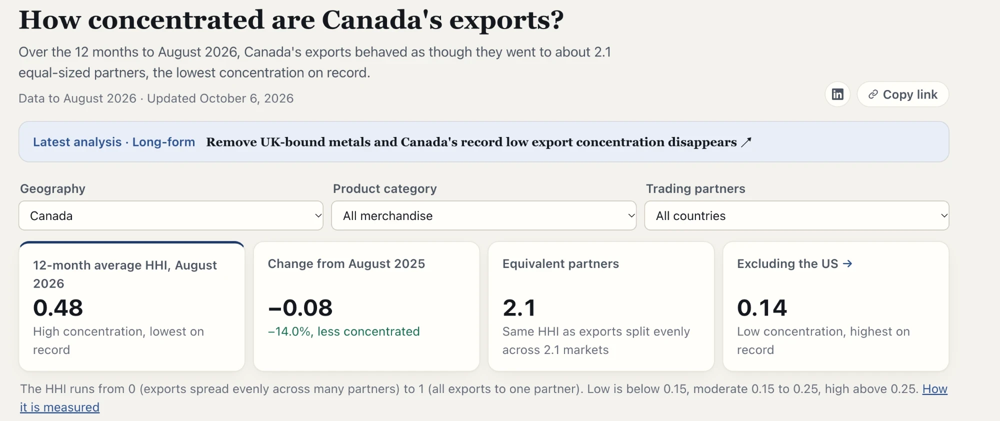
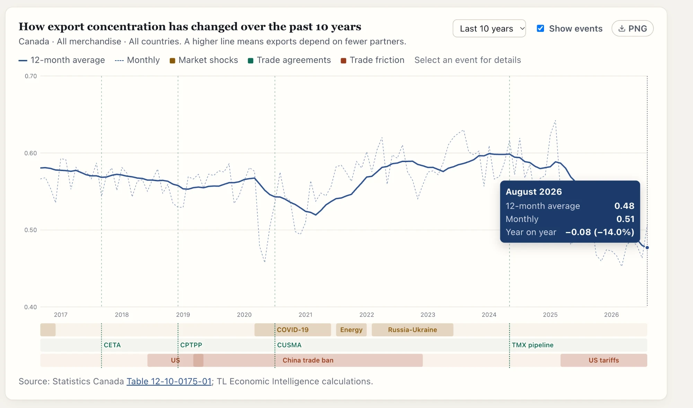

::: {.la-tool-shot}
{fig-alt="The dashboard's headline numbers: HHI of 0.48, about 2.1 equivalent partners, and 0.14 once the US is excluded"}

{fig-alt="Ten years of Canada's export concentration, with key trade events marked on the line"}
:::

[Open the tool ↗](https://tleconomicintel.com/hhi/){.la-btn target="_blank"}

## What it answers

- How concentrated are a country's exports, and is that rising or falling? The headline is the Herfindahl-Hirschman Index (HHI), from 0 (spread across many partners) to 1 (all to one partner).
- How many equal-sized partners would give the same concentration? The "equivalent partners" number turns the HHI into something you can picture.
- What happens without the US? Filter by province, product and trading partner, and see how far the new trade really reaches.
- Which events moved it? The full history has market shocks, trade agreements and trade friction marked, and every chart downloads as a PNG.

[Source: Statistics Canada, Table 12-10-0175-01; TL Economic Intelligence calculations.]{.la-small}

## Notebooks that use it

::: {#related}
:::
